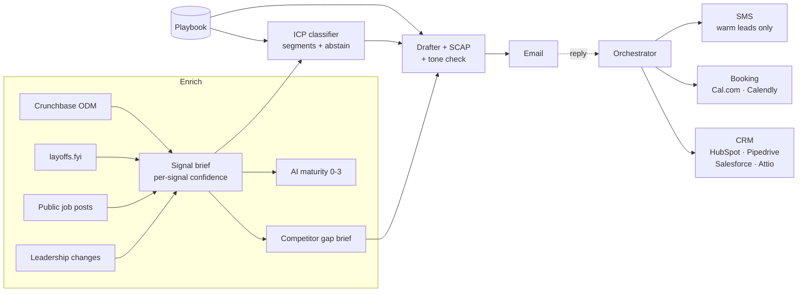

# Conversion Engine

[](https://github.com/Sanoy24/conversion-engine/actions/workflows/ci.yml)

**Signal-grounded B2B prospecting: research a company from public data, decide whether it's worth contacting, write an evidence-backed first email, handle replies, and book the meeting.**

Most outbound tools personalise with mail-merge fields. The Conversion Engine personalises with *evidence*, and it keeps track of how strong that evidence is:

- every signal (funding, hiring velocity, layoffs, leadership change, AI maturity) carries a **confidence level**
- the ICP classifier **abstains** instead of guessing when the evidence is thin
- the drafter's wording **follows the evidence** (SCAP): strong signals are stated, medium ones are hedged, weak ones become questions or are dropped

Everything company-specific (who you are, how you sound, who you sell to) lives in a **playbook**, so the same engine can sell for any company.

- **Stack:** Python 3.12 · FastAPI · [uv](https://docs.astral.sh/uv/) · OpenRouter (any chat model)
- **Integrations:** Email: Resend, SendGrid or any SMTP server (SES, Gmail, Postmark, ...) · SMS: Africa's Talking or Twilio · CRM: HubSpot (REST or MCP), Pipedrive, Salesforce or Attio · Calendar: Cal.com or Calendly · Langfuse
- **Status:** early / pre-1.0. Interfaces may change.

> ⚠️ **Safe by default.** `LIVE_OUTBOUND_ENABLED=false` is the default: no email or SMS is delivered, everything is logged to a sink. And with `REQUIRE_APPROVAL=true` (also the default) every drafted email waits in the [review queue](#review-queue) until a person approves it. Only enable live sending once you have reviewed drafts and are sure you're allowed to contact the recipients under the laws that apply to you (CAN-SPAM, GDPR/PECR, TCPA, ...).

---

## How it works



1. **Enrich:** builds a `HiringSignalBrief` from public data, with a confidence level and sources for every signal.
2. **Classify:** scores the brief against your playbook's segments. Low confidence → `abstain` → a generic exploratory email instead of a targeted pitch.
3. **Draft:** an LLM writes the email in your voice. SCAP rewrites the brief first, so the model never sees weak evidence presented as fact; a second LLM call scores tone and triggers one regeneration if it drifts.
4. **Review:** each drafted email waits in the review queue until someone approves, edits or rejects it.
5. **Deliver and follow up:** email first. SMS only once a prospect has replied (cold SMS is blocked in code). Bookings go to Cal.com or Calendly and every event goes to the CRM.

---

## Quick start

```bash
git clone https://github.com/Sanoy24/conversion-engine.git
cd conversion-engine

uv sync                                   # install dependencies
cp .env.example .env                      # then add at least OPENROUTER_API_KEY
uv run python -m scripts.fetch_data       # download public datasets into data/
uv run playwright install chromium        # only needed for live job-post crawling
uv run pytest -m "not slow and not live"  # sanity check
```

Run the API:

```bash
uv run uvicorn agent.main:app --reload

# The API is open in development; once API_KEY is set, add -H "X-API-Key: $API_KEY"
curl -X POST http://localhost:8000/api/prospect/new \
  -H "Content-Type: application/json" \
  -d '{"company_name": "Example Corp", "contact_email": "cto@example.com"}'
```

Or run one prospect through the whole thread (cold email → reply → SMS → booking → CRM):

```bash
uv run python -m scripts.run_full_thread_demo --company "Example Corp" --contact-email you@example.com
```

---

## Playbooks: making it sell for *your* company

A playbook is a directory with a `playbook.yaml` and the files it references. Select one with `PLAYBOOK_DIR`:

```bash
cp -r playbooks/example playbooks/my-company
# edit playbooks/my-company/*
PLAYBOOK_DIR=./playbooks/my-company uv run uvicorn agent.main:app
```

Everything except `playbooks/example/` is gitignored, so your real sales material stays out of the repo.

```yaml
company:
  name: Acme Engineering
  website: acme.example
  offering: Dedicated engineering teams and fixed-scope data/AI projects.
  sender_name: Sam
  sender_title: Research Partner
  support_email: hello@acme.example     # used in SMS HELP replies

voice:
  style_guide: style_guide.md           # markdown, injected into the prompt and used by the tone check
  subject_prefixes: ["Question on", "Context:"]
  banned_phrases: [world-class, rockstar]
  max_words: {cold: 120, warm_reply: 100, re_engagement: 70}
  extra_rules: ["Never quote prices in email."]
  tone_check_threshold: 0.7

capacity: capacity.json                 # optional; the agent never commits beyond this

segments:                               # priority order: first wins a tie
  - id: recently_funded
    label: Recently funded startup
    description: Series A/B in the last 6 months, 15-80 people.
    pitch: Frame around shipping faster than hiring alone allows.
    criteria:
      - when: {funding_rounds: [series a, series b]}
        weight: 3
      - when: {employees: {min: 15, max: 80}}
        weight: 1
    exclude:
      - layoffs: true

knowledge:                              # extra prompt context, per email type
  - path: knowledge/proof_points.md
    label: Proof points
    use_for: [warm_reply]
```

**Segment rules.** A segment is disqualified if any `exclude` condition matches or any `required: true` criterion fails. Otherwise its score is the sum of the weights of the criteria that matched. The highest score wins. If nothing scores, or the underlying signals are low-confidence, the classifier abstains.

| Condition | Matches when |
| --- | --- |
| `funding_rounds: [series a, ...]` | latest round is in the list |
| `employees: {min, max}` | headcount within bounds (either bound optional) |
| `layoffs: true\|false` | a layoff in the last 120 days was / wasn't found |
| `leadership_change: true\|false` | a new CTO / VP Eng in the last 90 days was / wasn't found |
| `ai_maturity_min: N` | AI-maturity score ≥ N (0-3) |
| `ai_roles_min: N` | ≥ N AI-adjacent open roles |
| `open_roles_min: N` | ≥ N open engineering roles |

See [playbooks/example/playbook.yaml](playbooks/example/playbook.yaml) for a complete, commented example.

---

## Configuration

Settings come from environment variables (or `.env`). See [.env.example](.env.example) for the full list.

| Variable | Purpose |
| --- | --- |
| `OPENROUTER_API_KEY` | LLM access (required) |
| `DEV_MODEL` / `EVAL_MODEL` | Model used when `APP_ENV` is `development` / `production` |
| `PLAYBOOK_DIR` | Active playbook. Default `./playbooks/example` |
| **`LIVE_OUTBOUND_ENABLED`** | **Kill switch.** Default `false`: nothing is delivered |
| `REQUIRE_APPROVAL` | Default `true`: drafted emails wait in the [review queue](#review-queue) |
| `FOLLOW_UP_DAYS` | Follow-up schedule for silent threads (default `3,7`; empty disables). See [Follow-ups](#follow-ups) |
| `DAILY_SEND_LIMIT`, `EMAIL_WARMUP_START` | Live emails per day (default 50), and a warm-up ramp for a new sending domain. See [Sending limits](#sending-limits) |
| `API_KEY` | Required on `/api/*`. Unset = open in development, closed in production |
| `PUBLIC_BASE_URL`, `UNSUBSCRIBE_SECRET` | Unsubscribe links. **Required for live email**: without them every send is refused |
| `CONVERSATION_DB_PATH` | SQLite file for threads and the suppression list. Default `./data/conversations.db`; empty = in memory |
| `EMAIL_PROVIDER`, `EMAIL_FROM` | `resend` (default), `sendgrid` or `smtp`, and the sender. See [Email providers](#email-providers) |
| `SMS_PROVIDER` | `africastalking` (default) or `twilio`. See [SMS providers](#sms-providers) |
| `CRM_PROVIDER` | `hubspot` (default), `pipedrive`, `salesforce` or `attio`. See [CRM providers](#crm-providers) |
| `CALENDAR_PROVIDER`, `SDR_EMAIL` | `calcom` (default) or `calendly`, and the SDR invited to every call. See [Calendar providers](#calendar-providers) |
| `LANGFUSE_PUBLIC_KEY`, `LANGFUSE_SECRET_KEY` | Tracing (optional; falls back to local JSONL) |
| `ENABLE_SCAP` (+ `SCAP_*` sub-flags) | Confidence-aware phrasing. Default on |

Integrations without credentials degrade gracefully: the stage records an error in its trace and the pipeline continues.

### Running on free models

A free OpenRouter key is enough to run the engine with nothing being sent (`LIVE_OUTBOUND_ENABLED=false`):

```
OPENROUTER_API_KEY=<free key>
DEV_MODEL=nvidia/nemotron-3.5-super-vl:free
EVAL_MODEL=nvidia/nemotron-3.5-super-vl:free
```

- Free accounts get 50 requests a day. Each prospect takes 2-3 (draft, tone check, sometimes a regeneration), so plan on 15-20 prospects a day. Reaching the daily limit stops the run with a clear error (HTTP 429) instead of retrying.
- Free models come and go and are often rate-limited upstream, so check the [current list](https://openrouter.ai/models?max_price=0). Pin one model rather than using `openrouter/free`, which picks at random and makes results hard to compare.
- Reasoning is turned off by default (`LLM_DISABLE_REASONING`), because reasoning models can otherwise spend the whole token budget thinking and return nothing.

### Email providers

Set `EMAIL_PROVIDER` and `EMAIL_FROM` (e.g. `Sam at Acme <sam@acme.example>`). Every provider sends the same message: plain text, the unsubscribe footer, and `List-Unsubscribe` / `List-Unsubscribe-Post` headers.

| Provider | Settings | Notes |
| --- | --- | --- |
| `resend` | `RESEND_API_KEY` | Default. Replies and bounces come back through `/webhooks/email/reply` |
| `sendgrid` | `SENDGRID_API_KEY` | v3 Mail Send API |
| `smtp` | `SMTP_HOST`, `SMTP_PORT` (587), `SMTP_USERNAME`, `SMTP_PASSWORD`; `SMTP_USE_SSL=true` for port 465 | Works with Amazon SES, Gmail/Workspace, Postmark, Mailgun or your own server. STARTTLS is on unless `SMTP_STARTTLS=false` |

Inbound replies and bounce/complaint events are only wired up for Resend so far. With SendGrid or SMTP, forward replies to `POST /api/prospect/reply` and add bounced addresses with `POST /api/suppressions`.

### SMS providers

SMS is for warm leads only (cold SMS is blocked in code). Set `SMS_PROVIDER` and that provider's settings; STOP and HELP are handled the same way for both.

| Provider | Settings | Inbound webhook |
| --- | --- | --- |
| `africastalking` | `AT_USERNAME`, `AT_API_KEY`, `AT_SHORTCODE`, `AT_WEBHOOK_TOKEN` | `POST /webhooks/sms/inbound?token=<AT_WEBHOOK_TOKEN>` |
| `twilio` | `TWILIO_ACCOUNT_SID`, `TWILIO_AUTH_TOKEN`, and `TWILIO_FROM_NUMBER` or `TWILIO_MESSAGING_SERVICE_SID` | `POST /webhooks/sms/twilio` (set as the number's "A message comes in" URL). Requires `PUBLIC_BASE_URL`, because Twilio signs the public URL |

### Calendar providers

Discovery calls are booked directly through the provider's API. `SDR_EMAIL` is added as a guest so both sides get an invite. Set `CALENDAR_PROVIDER` and that provider's settings.

| Provider | Settings | Notes |
| --- | --- | --- |
| `calcom` | `CALCOM_API_KEY`, `CALCOM_BASE_URL`, `CALCOM_EVENT_TYPE_ID`, `CALCOM_WEBHOOK_SECRET` | Cloud or self-hosted. Booking created / cancelled / rescheduled events come back through `/webhooks/calcom` |
| `calendly` | `CALENDLY_API_TOKEN`, `CALENDLY_EVENT_TYPE_URI`, `CALENDLY_SCHEDULING_URL`; `CALENDLY_LOCATION_KIND` (+ `CALENDLY_LOCATION`) if the event type has a location | Uses the Scheduling API (`POST /invitees`), which needs a paid Calendly plan. Calendly webhooks aren't handled yet, so bookings the prospect makes through the link aren't tracked automatically |

### CRM providers

Set `CRM_PROVIDER` and that provider's credentials. Every provider gets the same contact, notes and lead-status updates (`NEW`, `QUALIFIED`, `UNQUALIFIED`, `CALL_BOOKED`); re-running a prospect reuses the existing contact instead of creating a duplicate.

| Provider | Settings | Contact becomes | Notes become | Lead status |
| --- | --- | --- | --- | --- |
| `hubspot` | `HUBSPOT_ACCESS_TOKEN`; `USE_HUBSPOT_MCP=true` routes through `@hubspot/mcp-server` (Node 18+) | Contact + enrichment properties | Notes | `hs_lead_status` |
| `pipedrive` | `PIPEDRIVE_API_TOKEN`, `PIPEDRIVE_COMPANY_DOMAIN` (the `acme` in `acme.pipedrive.com`) | Person | Notes | Custom field `PIPEDRIVE_STATUS_FIELD` if set, otherwise a note |
| `salesforce` | `SALESFORCE_DOMAIN` (My Domain URL), `SALESFORCE_CLIENT_ID`, `SALESFORCE_CLIENT_SECRET` (client-credentials flow) | Lead | Completed Tasks | Lead `Status`; remap with `SALESFORCE_STATUS_MAP` |
| `attio` | `ATTIO_API_KEY` | People record (matched by email) | Notes | Attribute `ATTIO_STATUS_ATTRIBUTE` if set, otherwise a note |

Salesforce's default status map uses a standard org's picklist: `NEW` → `Open - Not Contacted`, `QUALIFIED`/`CALL_BOOKED` → `Working - Contacted`, `UNQUALIFIED` → `Closed - Not Converted`.

### Webhooks

| Route | Source | Authenticated by |
| --- | --- | --- |
| `POST /webhooks/email/reply` | Resend inbound / bounce events | Svix signature, `RESEND_WEBHOOK_SECRET` |
| `POST /webhooks/sms/inbound?token=...` | Africa's Talking (handles STOP / HELP) | URL token, `AT_WEBHOOK_TOKEN` |
| `POST /webhooks/sms/twilio` | Twilio inbound SMS (handles STOP / HELP) | `X-Twilio-Signature`, `TWILIO_AUTH_TOKEN` |
| `POST /webhooks/calcom` | Cal.com booking created / cancelled / rescheduled | `X-Cal-Signature-256`, `CALCOM_WEBHOOK_SECRET` |

### Authentication

`/api/*` requires `API_KEY`, sent as `X-API-Key: <key>` or `Authorization: Bearer <key>`. `/health`, `/unsubscribe` and the webhooks are public, and each webhook checks its own signature or token.

Every secret works the same way: when it is set it is always enforced; when it is unset, requests are accepted in development (with a warning) and **rejected in production** (`APP_ENV=production`). The app logs any missing secrets at startup.

### Review queue

With `REQUIRE_APPROVAL=true` (the default), every LLM-drafted email (cold outreach and warm replies) is queued instead of sent. Open **`/review`** in a browser to approve, edit or reject drafts; the page asks for your `API_KEY`. Drafts the engine flagged for human review (for example an unconfirmed leadership change) are marked "Needs attention".

- Approving sends through the normal path, so suppressed addresses are skipped and the kill switch still applies. Edits are stored next to the original draft.
- Rejecting sends nothing; the thread goes back to `new`.
- API: `GET /api/review?status=pending|sent|failed|rejected|all`, `POST /api/review/{id}/approve {"subject"?, "body"?}`, `POST /api/review/{id}/reject {"reason"?}`.

Set `REQUIRE_APPROVAL=false` to send drafts immediately (the full-thread demo script does this).

### Follow-ups

Cold threads that get no reply are followed up on a schedule: `FOLLOW_UP_DAYS=3,7` sends the first follow-up 3 days after the last email, the second 7 days after that, then marks the thread `stalled` and stops.

- Any reply or opt-out stops the sequence (the thread is no longer `outbound_sent`); suppressed contacts are skipped before anything is drafted.
- Timing counts from when an email was actually sent, so time spent in the review queue never shortens the gap; a follow-up waiting for review blocks the next one.
- Follow-ups are drafted like any email (`re_engagement`, with the thread history) and go through the review queue and sending limits.
- The app checks every `FOLLOW_UP_INTERVAL_MINUTES` (default 60). Set it to `0` and call `POST /api/follow-ups/run` from a cron instead if you prefer.

### Sending limits

Live email is capped to protect your sending domain's reputation (sink mode is never limited):

- **Daily cap:** `DAILY_SEND_LIMIT` (default 50) emails per UTC day.
- **Warm-up:** set `EMAIL_WARMUP_START` to the date a new domain started sending; the cap is 10/day in week one and doubles weekly until it reaches `DAILY_SEND_LIMIT`.
- **Auto-pause:** sending stops when the 7-day bounce rate exceeds `BOUNCE_PAUSE_RATE` (5%, once 20+ emails went out) or the spam-complaint rate exceeds `COMPLAINT_PAUSE_RATE` (0.3%, the Gmail/Yahoo threshold). At low volume a single complaint pauses. Bounces and complaints come from the Resend webhook.

A held email isn't lost: approving a draft over the cap leaves it pending in the review queue. `GET /api/sending` shows the cap, today's count and the 7-day rates; `POST /api/sending/pause {"reason"}` and `POST /api/sending/resume` control the pause (rates are measured afresh after a resume).

### Unsubscribe and suppression

Once an address is on the suppression list, the engine never contacts it again. The email and SMS senders check the list before every send, including in sink mode, and new prospects with a suppressed email are skipped before enrichment. An address is added when:

- the recipient clicks the unsubscribe link (or uses their mail client's one-click unsubscribe)
- they reply with an opt-out ("unsubscribe", "remove me", ...) or text STOP
- an email bounces or is marked as spam (Resend webhook)
- you add it by hand: `POST /api/suppressions {"address": "..."}`

Every email gets a footer with the playbook's `postal_address` and a signed unsubscribe link, plus `List-Unsubscribe` / `List-Unsubscribe-Post` headers. `GET /unsubscribe` shows a confirm button rather than unsubscribing outright, because mail scanners open links automatically. `GET /api/suppressions` lists the suppression list.

---

## Project layout

```text
agent/
  playbook.py        playbook schema + loader
  core/              orchestrator, ICP classifier, email drafter, SCAP, conversation store
  enrichment/        Crunchbase, job posts, layoffs, leadership, AI maturity, competitor gap
  channels/          email (Resend, SendGrid, SMTP), SMS (Africa's Talking, Twilio), handoff policy
  integrations/      CRMs (HubSpot REST + MCP, Pipedrive, Salesforce, Attio), calendars (Cal.com, Calendly)
  observability/     Langfuse + JSONL traces
playbooks/example/   fictional company playbook: copy this to start
scripts/             fetch_data, run_full_thread_demo, list_hubspot_mcp_tools
tests/
```

---

## Quality evaluations

`evals/` measures whether the engine picks the right pitch and writes honest emails. It runs on 30 fictional companies (`evals/cases.yaml`), each with a known signal brief and the segment the classifier should pick.

- **Classification:** does the classifier pick the expected segment, or abstain when nothing is justified? No LLM involved, so CI runs it on every change.
- **Drafts:** every case is drafted twice, as a cold email and as a follow-up (replying to a fixed, neutral first email). Deterministic checks, worked out from the case's own brief after SCAP, score each draft; no second LLM grades the first:
  - **Grounding:** every number and amount, including ones written as words ("fifteen roles"), traces to the brief (or, in sentences about the sender, to the playbook), withheld low-confidence signals stay out, layoffs are never mentioned, medium-confidence facts are hedged, no internal scoring terms, no invented names or meeting times.
  - **Voice:** word limit for the email type, banned phrases, subject rules, signature; follow-ups also must not use chaser phrases ("just following up", "circling back", ...).

```bash
uv run python -m evals.run                         # classification + score every recording
uv run python -m evals.run record --model <id>     # draft every case with a real model (needs OPENROUTER_API_KEY)
uv run python -m evals.run prompts out.json        # or export the exact prompts (--type cold|re_engagement)...
uv run python -m evals.run import --model <name> drafts.json   # ...and import drafts made elsewhere
```

Recordings live in `evals/recordings/`, so scoring is free and repeatable; CI fails if a case changes without re-recording.

**Current results** (drafts by Claude Haiku and Claude Sonnet given the exact drafter prompts, without the tone-check regeneration step):

| | Classification | Haiku cold | Sonnet cold | Haiku follow-up | Sonnet follow-up |
| --- | --- | --- | --- | --- |
| Before this suite | 22/30 | 26/30 (2 were check false positives) | 30/30 | not measured | not measured |
| Now | 30/30 | 30/30 | 30/30 | 30/30 | 30/30 |

On a free model, run through the full production path with the tone check, `nvidia/nemotron-3.5-super-vl:free` scored 6/8 clean on eight of the hardest cold cases. It still put a medium-confidence round in a subject line and mentioned "AI maturity" in one email, so review its drafts closely.

What changed: segments now require their core signal, low-confidence evidence can rule a segment out but never qualify it, and the drafter prompt forbids medium-confidence facts in subject lines and internal scoring terms in the email.

Limits: the checks are regex-based; passing them means an email is honest and on-voice, not that it's persuasive. Both models often reuse the prompt's example hedge ("Looking at the public signal, it seems") word for word, which no check penalises. Warm replies aren't evaluated yet, and the cases cover the example playbook only.

## Known limitations

- Conversations are kept in a local SQLite file (`CONVERSATION_DB_PATH`, default `./data/conversations.db`), so they survive restarts. It assumes a **single process**: run one uvicorn worker, and on hosts with an ephemeral filesystem (e.g. Render free plan) mount a persistent disk or threads are lost on redeploy. A shared Postgres store is planned.
- The API has a single shared key, with no per-user accounts or scopes.
- Calendly webhooks (bookings made through the link, cancellations) aren't handled yet; Cal.com's are.
- Inbound email (replies, bounces) is only handled for Resend.
- Enrichment is tuned for selling to software companies (it counts engineering roles).

---

## Development

```bash
uv run pytest                       # all tests
uv run pytest -m "not slow and not live"
uv run ruff check . && uv run ruff format .
```

## License

[MIT](LICENSE)

## Data and attribution

- Crunchbase ODM sample: Apache 2.0, [luminati-io/Crunchbase-dataset-samples](https://github.com/luminati-io/Crunchbase-dataset-samples)
- layoffs.fyi data: CC-BY, via a public mirror (see `scripts/fetch_data.py`)
- Datasets are downloaded on demand, not redistributed in this repo. Third-party services are governed by their own terms.

Job-post collection uses public pages only: no logins, no captcha bypassing, robots.txt respected.
