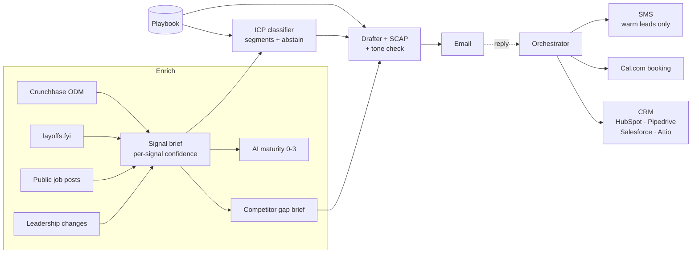

# Conversion Engine

[](https://github.com/Sanoy24/conversion-engine/actions/workflows/ci.yml)

**Signal-grounded B2B prospecting: research a company from public data, decide whether it's worth contacting, write an evidence-backed first email, handle replies, and book the meeting.**

Most outbound tools personalise with mail-merge fields. The Conversion Engine personalises with *evidence*, and it keeps track of how strong that evidence is:

- every signal (funding, hiring velocity, layoffs, leadership change, AI maturity) carries a **confidence level**
- the ICP classifier **abstains** instead of guessing when the evidence is thin
- the drafter's wording **follows the evidence** (SCAP): strong signals are stated, medium ones are hedged, weak ones become questions or are dropped

Everything company-specific (who you are, how you sound, who you sell to) lives in a **playbook**, so the same engine can sell for any company.

- **Stack:** Python 3.12 · FastAPI · [uv](https://docs.astral.sh/uv/) · OpenRouter (any chat model)
- **Integrations:** Resend (email) · Africa's Talking (SMS) · CRM: HubSpot (REST or MCP), Pipedrive, Salesforce or Attio · Cal.com · Langfuse
- **Status:** early / pre-1.0. Interfaces may change.

> ⚠️ **Safe by default.** `LIVE_OUTBOUND_ENABLED=false` is the default: no email or SMS is delivered, everything is logged to a sink. Only enable live sending once you have reviewed drafts and are sure you're allowed to contact the recipients under the laws that apply to you (CAN-SPAM, GDPR/PECR, TCPA, ...).

---

## How it works



1. **Enrich:** builds a `HiringSignalBrief` from public data, with a confidence level and sources for every signal.
2. **Classify:** scores the brief against your playbook's segments. Low confidence → `abstain` → a generic exploratory email instead of a targeted pitch.
3. **Draft:** an LLM writes the email in your voice. SCAP rewrites the brief first, so the model never sees weak evidence presented as fact; a second LLM call scores tone and triggers one regeneration if it drifts.
4. **Deliver and follow up:** email first. SMS only once a prospect has replied (cold SMS is blocked in code). Bookings go to Cal.com and every event goes to the CRM.

---

## Quick start

```bash
git clone https://github.com/Sanoy24/conversion-engine.git
cd conversion-engine

uv sync                                   # install dependencies
cp .env.example .env                      # then add at least OPENROUTER_API_KEY
uv run python -m scripts.fetch_data       # download public datasets into data/
uv run playwright install chromium        # only needed for live job-post crawling
uv run pytest -m "not slow and not live"  # sanity check
```

Run the API:

```bash
uv run uvicorn agent.main:app --reload

# The API is open in development; once API_KEY is set, add -H "X-API-Key: $API_KEY"
curl -X POST http://localhost:8000/api/prospect/new \
  -H "Content-Type: application/json" \
  -d '{"company_name": "Example Corp", "contact_email": "cto@example.com"}'
```

Or run one prospect through the whole thread (cold email → reply → SMS → booking → CRM):

```bash
uv run python -m scripts.run_full_thread_demo --company "Example Corp" --contact-email you@example.com
```

---

## Playbooks: making it sell for *your* company

A playbook is a directory with a `playbook.yaml` and the files it references. Select one with `PLAYBOOK_DIR`:

```bash
cp -r playbooks/example playbooks/my-company
# edit playbooks/my-company/*
PLAYBOOK_DIR=./playbooks/my-company uv run uvicorn agent.main:app
```

Everything except `playbooks/example/` is gitignored, so your real sales material stays out of the repo.

```yaml
company:
  name: Acme Engineering
  website: acme.example
  offering: Dedicated engineering teams and fixed-scope data/AI projects.
  sender_name: Sam
  sender_title: Research Partner
  support_email: hello@acme.example     # used in SMS HELP replies

voice:
  style_guide: style_guide.md           # markdown, injected into the prompt and used by the tone check
  subject_prefixes: ["Question on", "Context:"]
  banned_phrases: [world-class, rockstar]
  max_words: {cold: 120, warm_reply: 100, re_engagement: 70}
  extra_rules: ["Never quote prices in email."]
  tone_check_threshold: 0.7

capacity: capacity.json                 # optional; the agent never commits beyond this

segments:                               # priority order: first wins a tie
  - id: recently_funded
    label: Recently funded startup
    description: Series A/B in the last 6 months, 15-80 people.
    pitch: Frame around shipping faster than hiring alone allows.
    criteria:
      - when: {funding_rounds: [series a, series b]}
        weight: 3
      - when: {employees: {min: 15, max: 80}}
        weight: 1
    exclude:
      - layoffs: true

knowledge:                              # extra prompt context, per email type
  - path: knowledge/proof_points.md
    label: Proof points
    use_for: [warm_reply]
```

**Segment rules.** A segment is disqualified if any `exclude` condition matches or any `required: true` criterion fails. Otherwise its score is the sum of the weights of the criteria that matched. The highest score wins. If nothing scores, or the underlying signals are low-confidence, the classifier abstains.

| Condition | Matches when |
| --- | --- |
| `funding_rounds: [series a, ...]` | latest round is in the list |
| `employees: {min, max}` | headcount within bounds (either bound optional) |
| `layoffs: true\|false` | a layoff in the last 120 days was / wasn't found |
| `leadership_change: true\|false` | a new CTO / VP Eng in the last 90 days was / wasn't found |
| `ai_maturity_min: N` | AI-maturity score ≥ N (0-3) |
| `ai_roles_min: N` | ≥ N AI-adjacent open roles |
| `open_roles_min: N` | ≥ N open engineering roles |

See [playbooks/example/playbook.yaml](playbooks/example/playbook.yaml) for a complete, commented example.

---

## Configuration

Settings come from environment variables (or `.env`). See [.env.example](.env.example) for the full list.

| Variable | Purpose |
| --- | --- |
| `OPENROUTER_API_KEY` | LLM access (required) |
| `DEV_MODEL` / `EVAL_MODEL` | Model used when `APP_ENV` is `development` / `production` |
| `PLAYBOOK_DIR` | Active playbook. Default `./playbooks/example` |
| **`LIVE_OUTBOUND_ENABLED`** | **Kill switch.** Default `false`: nothing is delivered |
| `API_KEY` | Required on `/api/*`. Unset = open in development, closed in production |
| `PUBLIC_BASE_URL`, `UNSUBSCRIBE_SECRET` | Unsubscribe links. **Required for live email**: without them every send is refused |
| `CONVERSATION_DB_PATH` | SQLite file for threads and the suppression list. Default `./data/conversations.db`; empty = in memory |
| `RESEND_API_KEY`, `RESEND_FROM_EMAIL`, `RESEND_WEBHOOK_SECRET` | Email |
| `AT_USERNAME`, `AT_API_KEY`, `AT_SHORTCODE`, `AT_WEBHOOK_TOKEN` | SMS (Africa's Talking) |
| `CRM_PROVIDER` | `hubspot` (default), `pipedrive`, `salesforce` or `attio`. See [CRM providers](#crm-providers) |
| `CALCOM_API_KEY`, `CALCOM_BASE_URL`, `CALCOM_EVENT_TYPE_ID`, `CALCOM_WEBHOOK_SECRET`, `SDR_EMAIL` | Booking |
| `LANGFUSE_PUBLIC_KEY`, `LANGFUSE_SECRET_KEY` | Tracing (optional; falls back to local JSONL) |
| `ENABLE_SCAP` (+ `SCAP_*` sub-flags) | Confidence-aware phrasing. Default on |

Integrations without credentials degrade gracefully: the stage records an error in its trace and the pipeline continues.

### CRM providers

Set `CRM_PROVIDER` and that provider's credentials. Every provider gets the same contact, notes and lead-status updates (`NEW`, `QUALIFIED`, `UNQUALIFIED`, `CALL_BOOKED`); re-running a prospect reuses the existing contact instead of creating a duplicate.

| Provider | Settings | Contact becomes | Notes become | Lead status |
| --- | --- | --- | --- | --- |
| `hubspot` | `HUBSPOT_ACCESS_TOKEN`; `USE_HUBSPOT_MCP=true` routes through `@hubspot/mcp-server` (Node 18+) | Contact + enrichment properties | Notes | `hs_lead_status` |
| `pipedrive` | `PIPEDRIVE_API_TOKEN`, `PIPEDRIVE_COMPANY_DOMAIN` (the `acme` in `acme.pipedrive.com`) | Person | Notes | Custom field `PIPEDRIVE_STATUS_FIELD` if set, otherwise a note |
| `salesforce` | `SALESFORCE_DOMAIN` (My Domain URL), `SALESFORCE_CLIENT_ID`, `SALESFORCE_CLIENT_SECRET` (client-credentials flow) | Lead | Completed Tasks | Lead `Status`; remap with `SALESFORCE_STATUS_MAP` |
| `attio` | `ATTIO_API_KEY` | People record (matched by email) | Notes | Attribute `ATTIO_STATUS_ATTRIBUTE` if set, otherwise a note |

Salesforce's default status map uses a standard org's picklist: `NEW` → `Open - Not Contacted`, `QUALIFIED`/`CALL_BOOKED` → `Working - Contacted`, `UNQUALIFIED` → `Closed - Not Converted`.

### Webhooks

| Route | Source | Authenticated by |
| --- | --- | --- |
| `POST /webhooks/email/reply` | Resend inbound / bounce events | Svix signature, `RESEND_WEBHOOK_SECRET` |
| `POST /webhooks/sms/inbound?token=...` | Africa's Talking (handles STOP / HELP) | URL token, `AT_WEBHOOK_TOKEN` |
| `POST /webhooks/calcom` | Cal.com booking created / cancelled / rescheduled | `X-Cal-Signature-256`, `CALCOM_WEBHOOK_SECRET` |

### Authentication

`/api/*` requires `API_KEY`, sent as `X-API-Key: <key>` or `Authorization: Bearer <key>`. `/health`, `/unsubscribe` and the webhooks are public, and each webhook checks its own signature or token.

Every secret works the same way: when it is set it is always enforced; when it is unset, requests are accepted in development (with a warning) and **rejected in production** (`APP_ENV=production`). The app logs any missing secrets at startup.

### Unsubscribe and suppression

Once an address is on the suppression list, the engine never contacts it again. The email and SMS senders check the list before every send, including in sink mode, and new prospects with a suppressed email are skipped before enrichment. An address is added when:

- the recipient clicks the unsubscribe link (or uses their mail client's one-click unsubscribe)
- they reply with an opt-out ("unsubscribe", "remove me", ...) or text STOP
- an email bounces or is marked as spam (Resend webhook)
- you add it by hand: `POST /api/suppressions {"address": "..."}`

Every email gets a footer with the playbook's `postal_address` and a signed unsubscribe link, plus `List-Unsubscribe` / `List-Unsubscribe-Post` headers. `GET /unsubscribe` shows a confirm button rather than unsubscribing outright, because mail scanners open links automatically. `GET /api/suppressions` lists the suppression list.

---

## Project layout

```text
agent/
  playbook.py        playbook schema + loader
  core/              orchestrator, ICP classifier, email drafter, SCAP, conversation store
  enrichment/        Crunchbase, job posts, layoffs, leadership, AI maturity, competitor gap
  channels/          email (Resend), SMS (Africa's Talking), handoff policy
  integrations/      CRMs (HubSpot REST + MCP, Pipedrive, Salesforce, Attio), Cal.com
  observability/     Langfuse + JSONL traces
playbooks/example/   fictional company playbook: copy this to start
scripts/             fetch_data, run_full_thread_demo, list_hubspot_mcp_tools
tests/
```

---

## Known limitations

- Conversations are kept in a local SQLite file (`CONVERSATION_DB_PATH`, default `./data/conversations.db`), so they survive restarts. It assumes a **single process**: run one uvicorn worker, and on hosts with an ephemeral filesystem (e.g. Render free plan) mount a persistent disk or threads are lost on redeploy. A shared Postgres store is planned.
- The API has a single shared key, with no per-user accounts or scopes.
- Email (Resend), SMS (Africa's Talking) and calendar (Cal.com) providers are still fixed; making them pluggable like the CRM is planned.
- Enrichment is tuned for selling to software companies (it counts engineering roles).

---

## Development

```bash
uv run pytest                       # all tests
uv run pytest -m "not slow and not live"
uv run ruff check . && uv run ruff format .
```

## License

[MIT](LICENSE)

## Data and attribution

- Crunchbase ODM sample: Apache 2.0, [luminati-io/Crunchbase-dataset-samples](https://github.com/luminati-io/Crunchbase-dataset-samples)
- layoffs.fyi data: CC-BY, via a public mirror (see `scripts/fetch_data.py`)
- Datasets are downloaded on demand, not redistributed in this repo. Third-party services are governed by their own terms.

Job-post collection uses public pages only: no logins, no captcha bypassing, robots.txt respected.
